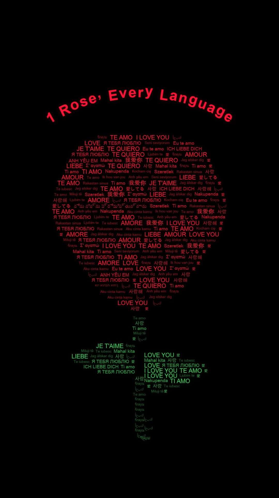

# 🌹 1 ROSE, EVERY LANGUAGE — Multilingual Typographic Text Animation

A visually stunning creative-coding typographic animation that forms a complete, organic rose flower, stem, and leaves using hundreds of romantic words meaning **"I LOVE YOU"** across global languages and authentic scripts.



---

## 🎨 Visual Concept & Design

- **Pure Black Canvas** (`#000000`): High-contrast minimalist background designed for mobile displays and social reels.
- **Silhouette Geometry**: A natural, layered rose silhouette constructed entirely from text lines with varied widths and font tiers:
  - **Rose Head**: Wide, rounded petals in crimson red, ruby, and dark pink typography (`#EB1432`, `#C30F28`, `#960A1E`).
  - **Stem & Leaves**: Emerald, leaf green, and deep forest green typography with pointed natural leaf shapes (`#34CD58`, `#229B42`, `#12692A`).
- **Arched Header**: Prominent arched title reading **"1 Rose, Every Language"** gracefully curving over the flower head.
- **Multilingual Scripts**: Authentic Unicode fonts supporting global languages including:
  - English (*I LOVE YOU*), Spanish (*TE AMO*), French (*JE T'AIME*, *AMOUR*), Italian (*TI AMO*), German (*ICH LIEBE DICH*), Swahili (*NAKUPENDA*), Korean (*사랑해*), Japanese (*愛してる*), Chinese (*我爱你*), Arabic (*أحبك*), Russian (*Я ТЕБЯ ЛЮБЛЮ*), Portuguese (*Eu te amo*), Telugu (*నేను నిన్ను ప్రేమిస్తున్నాను*), Polish (*Kocham cię*), Vietnamese (*ANH YÊU EM*), Hebrew (*אני אוהבת אותך*), Greek (*Σ' αγαπώ*), and more.

---

## 🎬 Video Specifications

| Parameter | Value |
| :--- | :--- |
| **Output File** | `typographic_rose.mp4` |
| **Resolution** | **1080 × 1920** (Vertical 9:16 Portrait) |
| **Framerate** | **30 FPS** |
| **Duration** | **14.0 seconds** (420 frames) |
| **Codec** | H.264 / MP4 (High profile, CRF 15, YUV420p) |
| **Glow & Bloom** | Multi-scale Gaussian bloom glow with post-assembly organic breathing shimmer |

---

## ⏱️ Animation Timeline

1. **$0.0\text{s} - 1.8\text{s}$ — Header Reveal**: Arched title *"1 Rose, Every Language"* gracefully fades in at the top.
2. **$1.8\text{s} - 5.0\text{s}$ — Core Blossom**: Central rose petal rows begin flying in from curved trajectories, assembling the inner core.
3. **$5.0\text{s} - 8.5\text{s}$ — Petal Expansion**: Outer and layered petals arrive with smooth quintic easing, completing the wide rounded rose head.
4. **$8.6\text{s} - 9.2\text{s}$ — Receptacle & Sepals**: Emerald green typography forms the base beneath the blossom.
5. **$9.2\text{s} - 9.8\text{s}$ — Foliage Unfolding**: Left and right green leaves emerge outward from the stem with natural curvature.
6. **$9.8\text{s} - 11.2\text{s}$ — Stem Descent**: Long green stem descends to the base of the frame.
7. **$11.2\text{s} - 14.0\text{s}$ — Final Illumination**: Complete multilingual text rose gently breathes with pulsating luminescence and soft additive bloom.

---

## 🚀 Getting Started

### 1. Prerequisites
Ensure you have Python 3.10+ and [FFmpeg](https://ffmpeg.org/) installed and available in your system `PATH`.

### 2. Install Dependencies
```bash
pip install -r requirements.txt
```

### 3. Generate the Animation
```bash
python typographic_rose.py
```

The script will automatically compile all font glyphs, layout the silhouette lines, and encode the final high-definition `typographic_rose.mp4` video.

---

## 📁 Repository Structure

```text
typographic-rose/
├── README.md                          # Project documentation and specifications
├── requirements.txt                   # Python dependencies (NumPy, OpenCV, Pillow)
├── .gitignore                         # Standard git ignore rules
├── typographic_rose.py                # Main animation generator (1080x1920, 9:16)
├── typographic_rose_preview.png       # 9:16 vertical poster preview
├── typographic_rose_16_9_preview.png  # 16:9 landscape poster preview
├── typographic_rose.mp4               # Rendered 1080x1920 MP4 video
└── particle_rose.py                   # Companion 3D particle rose animation
```

---

## 📄 License
MIT License. Created for creative-coding art and motion graphics.
